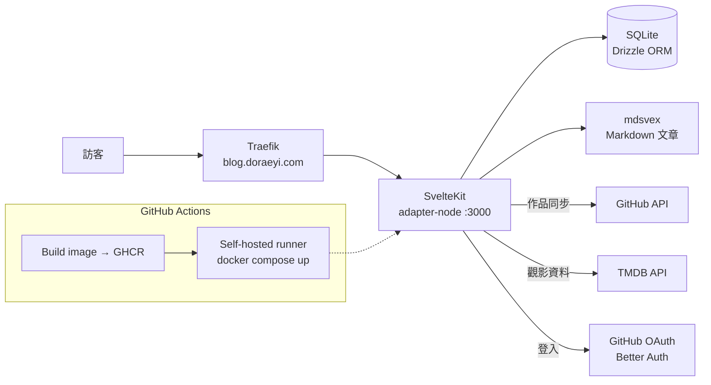

<div align="center">

# 偵探手記 · my-blog

**Liam 的個人網站：技術文章、心情、碎念、作品集與觀影紀錄**


🔗 <https://blog.doraeyi.com>

</div>

---

## 📖 簡介

這是一個以「偵探手記」為主題的個人網站：文章像案件檔案、作品像證物，搭配打字機字體、檔案紙質感與 Three.js 3D 案桌場景。網站本身就是作品集的一部分，所以互動與動畫都刻意做足，手機上則改用較輕的版本。

內容來源有兩種：mdsvex 寫的 Markdown 文章，以及存在 SQLite 的文章、心情、碎念；作品集從 GitHub 同步，觀影紀錄從 TMDB 取得。

## ✨ 功能特色

| 區塊 | 內容 |
| --- | --- |
| ✍️ 寫作 | 技術文章 `articles`、部落格 `blog`、心情 `moods`、碎念 `thinking` |
| 🗂️ 作品集 | `portfolio`：後台一鍵從 GitHub 同步 repo |
| 🎬 觀影紀錄 | `watch`：串接 TMDB |
| 📚 其他 | 書架、友站連結、留言板、Now 頁、網站歷史、時間軸封存、標籤索引 |
| 🔍 探索 | ⌘K 搜尋面板、RSS、Sitemap、自動產生 OG 圖（satori + resvg） |
| 🌗 體驗 | 淺色 / 深色主題、繁中 / 英文（Paraglide）、3D 案桌首頁 |
| 🔐 後台 | GitHub 登入（Better Auth）、內容管理、頁面留言 |

## 🏗️ 系統架構



## 🧰 技術棧

| 類別 | 技術 |
| --- | --- |
| 框架 | SvelteKit 2、Svelte 5、TypeScript、Vite |
| 樣式 | Tailwind CSS 4（typography、forms） |
| 內容 | mdsvex、Mermaid、自製 `@doraeyi/content-toolkit` |
| 3D / 圖片 | Three.js、satori + @resvg/resvg-js（OG 圖） |
| 資料庫 | SQLite（better-sqlite3）+ Drizzle ORM |
| 認證 | Better Auth（GitHub OAuth） |
| 多語系 | Paraglide JS（`zh-tw`、`en`） |
| 品質 | ESLint、Prettier、svelte-check |
| 部署 | Docker、GHCR、GitHub Actions（self-hosted runner）、Traefik |

## 📂 專案結構

```text
my-blog/
├── src/
│   ├── routes/              # articles、blog、moods、thinking、portfolio、watch、admin…
│   └── lib/
│       ├── components/
│       ├── content/           # Markdown 文章
│       └── server/            # auth、db、og 圖、內容索引、留言
├── packages/content-toolkit/  # 共用的內容處理工具
├── drizzle/                 # 資料庫 migration
├── messages/                # zh-tw.json、en.json
├── deploy/                  # Caddyfile、systemd、資料庫備份腳本
├── .github/workflows/deploy.yml
├── Dockerfile / docker-compose.yml
└── PRODUCT.md / DESIGN.md   # 產品定位與設計系統
```

## 🚀 快速開始

```bash
pnpm install
cp .env.example .env
pnpm db:push        # 依 schema 建立 SQLite 資料表
pnpm dev            # http://localhost:5173
```

常用指令：

| 指令 | 用途 |
| --- | --- |
| `pnpm check` | svelte-check 型別檢查 |
| `pnpm lint` / `pnpm format` | ESLint / Prettier |
| `pnpm db:generate` / `db:migrate` / `db:studio` | Drizzle migration 與管理介面 |
| `pnpm build` / `pnpm preview` | 打包與預覽正式版 |

## ⚙️ 環境變數

| 變數 | 說明 |
| --- | --- |
| `DATABASE_URL` | SQLite 檔案路徑 |
| `ORIGIN` | 網站網址 |
| `BETTER_AUTH_SECRET` | 32 字元以上的隨機字串 |
| `GITHUB_CLIENT_ID` / `GITHUB_CLIENT_SECRET` | GitHub OAuth 登入 |
| `GITHUB_TOKEN` / `GITHUB_USERNAME` | 作品集同步（需 repo 讀取權限） |
| `TMDB_API_KEY` | 觀影紀錄 |

## 🚢 部署

push 到 `main` 後 GitHub Actions 會：

1. 建置 Docker image 並推到 `ghcr.io/doraeyi/my-blog`
2. 由 VM 上的 self-hosted runner 拉新 image，`docker compose up -d` 重啟

容器透過外部 `web` network 掛在 Traefik 後面，依 `Host(blog.doraeyi.com)` 轉發；SQLite 檔案掛在 `./data` volume。

## 📚 相關文件

- [`PRODUCT.md`](PRODUCT.md) — 產品定位、目標讀者、品牌原則
- [`DESIGN.md`](DESIGN.md) — 設計系統
